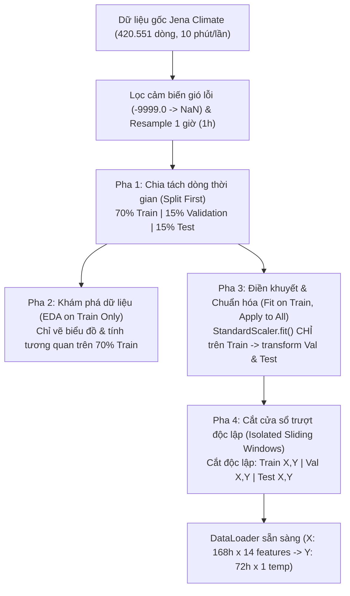

# ĐẶC TẢ KỸ THUẬT TIỀN XỬ LÝ DỮ LIỆU & QUY TẮC CHỐNG RÒ RỈ (DATA SPEC)

---

## 1. Purpose (Mục đích)
- **Mục tiêu bài toán:** Xây dựng quy trình xử lý dữ liệu chuỗi thời gian khí tượng từ bộ dữ liệu **Jena Climate** (do Viện Hóa Địa sinh học Max Planck thu thập tại Jena, Đức), phục vụ mô hình học sâu chuỗi-sang-chuỗi (Seq2Seq) dự báo nhiệt độ liên tục trong **72 giờ (3 ngày)** dựa trên **168 giờ (7 ngày)** lịch sử.
- **Tính toàn vẹn khoa học (Anti-Data Leakage):** Hiện tượng "rò rỉ dữ liệu" (Data Leakage) là nguyên nhân hàng đầu khiến các mô hình chuỗi thời gian đạt độ chính xác ảo khi huấn luyện nhưng thất bại hoàn toàn ngoài thực tế (theo nghiên cứu của Kapoor & Narayanan, Đại học Princeton, 2023). Tài liệu này thiết lập **Quy trình 4 pha chống rò rỉ dữ liệu nghiêm ngặt (Strict Anti-Leakage Protocol)**, tuân thủ hướng dẫn Scikit-Learn (Section 12.2) và ISLR (James et al., Section 5.1.5).



---

## 2. Input / Output Contract (Đặc tả Đầu vào & Đầu ra)

### 2.1 Đầu vào gốc (Raw Input)
- **Đường dẫn tệp:** `data/jena_climate_2009_2016.csv`
- **Kích thước gốc:** ~420.551 dòng, tần suất đo 10 phút/lần (từ 01/01/2009 đến 31/12/2016).
- **Danh sách 14 đặc trưng khí tượng được sử dụng:**
  1. `p (mbar)`: Áp suất khí quyển.
  2. `T (degC)`: Nhiệt độ không khí (**Biến mục tiêu cần dự báo**).
  3. `Tpot (K)`: Nhiệt độ thế vị.
  4. `Tdew (degC)`: Nhiệt độ điểm sương.
  5. `rh (%)`: Độ ẩm tương đối.
  6. `VPmax (mbar)`: Áp suất hơi bão hòa.
  7. `VPact (mbar)`: Áp suất hơi thực tế.
  8. `VPdef (mbar)`: Độ hụt áp suất hơi.
  9. `sh (g/kg)`: Độ ẩm riêng.
  10. `H2OC (mmol/mol)`: Nồng độ hơi nước.
  11. `rho (g/m**3)`: Mật độ không khí.
  12. `wv (m/s)`: Vận tốc gió.
  13. `max. wv (m/s)`: Vận tốc gió tối đa.
  14. `wd (deg)`: Hướng gió theo độ góc.

### 2.2 Đầu ra sau tiền xử lý (Processed Output)
- **Dữ liệu sau khi Resample 1h:** ~70.091 dòng, mỗi dòng đại diện cho giá trị trung bình trong đúng 1 giờ độc lập.
- **Phân chia 3 tập theo tỷ lệ thời gian:**
  - `train_df`: 70% đầu tiên (~49.063 giờ).
  - `val_df`: 15% tiếp theo (~10.514 giờ).
  - `test_df`: 15% cuối cùng (~10.514 giờ).
- **Bộ chuẩn hóa:** Đối tượng `StandardScaler` lưu trữ giá trị $\mu_{train}$ và $\sigma_{train}$ của 14 thuộc tính từ duy nhất `train_df`.
- **Kích thước Tensor cung cấp bởi DataLoader:**
  - Đầu vào quá khứ ($X$): Tensor float32 kích thước `(Batch_size, 168, 14)` — tức 168 giờ lịch sử của đầy đủ 14 biến.
  - Nhãn tương lai ($Y$): Tensor float32 kích thước `(Batch_size, 72, 1)` — tức 72 giờ nhiệt độ `T (degC)` tiếp theo.

---

## 3. Success Criteria (Tiêu chí Nghiệm thu & Kiểm thử Tự động)

Hệ thống bắt buộc phải vượt qua các bài kiểm tra tự động (`assert`) sau:

1. **Chứng minh không rò rỉ thời gian (Zero Time Leakage):**
   $$\max(\text{train\_df.index}) < \min(\text{val\_df.index}) < \max(\text{val\_df.index}) < \min(\text{test\_df.index})$$
   Tuyệt đối không có bất kỳ mốc thời gian nào của tập trước chạm tới hoặc vượt qua tập sau.
2. **Chứng minh bộ chuẩn hóa không nhìn trộm (Zero Scaler Leakage):**
   $$\text{scaler.n\_samples\_seen\_} == \text{len(train\_df)}$$
   Hàm `.fit()` chỉ tính toán trên đúng số lượng dòng của `train_df`.
3. **Cửa sổ trượt độc lập hoàn toàn (Isolated Windows):**
   Mỗi mẫu trong tập Train, Val, Test phải nằm trọn vẹn trong khoảng chỉ số của tập đó. Tuyệt đối không cho phép mẫu dữ liệu nằm vắt ngang qua ranh giới Train $\rightarrow$ Val hoặc Val $\rightarrow$ Test.
4. **Lọc sạch dữ liệu hỏng:**
   Toàn bộ giá trị cảm biến gió lỗi `wv = -9999.0` được thay thế bằng `NaN` và được điền khuyết nội bộ bằng phương pháp `ffill()` và `bfill()` trong phạm vi từng tập riêng biệt.

---

## 4. How to do (Quy trình Hiện thực 4 Pha Chi Tiết)

### Pha 1: Chia tách dữ liệu theo dòng thời gian (Split First)
1. Đọc file CSV bằng `pandas`, chuyển cột thời gian sang kiểu `pd.to_datetime` và gán làm chỉ số (Index).
2. Thay thế giá trị $-9999.0$ tại các cột đo gió thành `np.nan`.
3. Gọi hàm `.resample('1h').mean()` để tính giá trị trung bình trong từng khung giờ độc lập.
4. Chia cắt dữ liệu thành 3 DataFrame:
   ```python
   n = len(hourly_df)
   train_df = hourly_df.iloc[: int(n * 0.70)]
   val_df   = hourly_df.iloc[int(n * 0.70) : int(n * 0.85)]
   test_df  = hourly_df.iloc[int(n * 0.85) :]
   ```

### Pha 2: Khám phá dữ liệu chỉ trên tập Train (EDA on Train Only)
- Toàn bộ các phân tích thống kê, phân phối nhiệt độ, chu kỳ ngày/đêm và ma trận tương quan Pearson đều được thực hiện **DUY NHẤT trên `train_df`**.
- Không được vẽ hoặc tính toán bất kỳ chỉ số thống kê mô tả nào trên `val_df` hoặc `test_df`.

### Pha 3: Điền khuyết và Chuẩn hóa (Fit on Train, Apply to All)
1. Điền giá trị khuyết thiếu trong nội bộ từng DataFrame:
   ```python
   train_clean = train_df.ffill().bfill().values
   val_clean   = val_df.ffill().bfill().values
   test_clean  = test_df.ffill().bfill().values
   ```
2. Khởi tạo `StandardScaler()` và **chỉ gọi `.fit()` trên `train_clean`**:
   ```python
   scaler = StandardScaler()
   train_scaled = scaler.fit_transform(train_clean)
   val_scaled   = scaler.transform(val_clean)
   test_scaled  = scaler.transform(test_clean)
   ```

### Pha 4: Tạo cửa sổ trượt độc lập (Isolated Sliding Windows)
Tạo đối tượng `SlidingWindowDataset` độc lập cho từng tập dữ liệu đã chuẩn hóa:
```python
# Cắt cửa sổ nội bộ trong từng tập
train_dataset = SlidingWindowDataset(train_scaled, seq_len=168, pred_len=72, target_idx=1)
val_dataset   = SlidingWindowDataset(val_scaled,   seq_len=168, pred_len=72, target_idx=1)
test_dataset  = SlidingWindowDataset(test_scaled,  seq_len=168, pred_len=72, target_idx=1)
```

### Hàm kiểm định tự động (Verification Snippet)
```python
def verify_zero_leakage(train_df, val_df, test_df, scaler):
    assert train_df.index.max() < val_df.index.min(), "Leakage: Train overlaps Val"
    assert val_df.index.max() < test_df.index.min(), "Leakage: Val overlaps Test"
    assert scaler.n_samples_seen_ == len(train_df), "Leakage: Scaler saw non-train data"
    print("Zero Leakage Verification PASSED!")
```

---

## 5. Smoke Test & Verification (Hướng Dẫn Kiểm Thử & Đầu Ra Mẫu)

### 5.1 Hướng dẫn kiểm thử nhanh (Smoke Test Instructions)

Mục đích của bài kiểm thử khói (**Smoke Test**) là kiểm chứng toàn bộ quy trình tiền xử lý dữ liệu và cam kết **Zero Data Leakage** trong vòng chưa đầy **3 giây** mà không cần đợi tải toàn bộ tập dữ liệu gốc 420.551 dòng.

#### Các tiêu chí kiểm thử bắt buộc:
1. **Lọc sạch dữ liệu cảm biến lỗi:** Giá trị âm cực đoan `-9999.0` của cảm biến vận tốc gió phải được thay thế bằng `NaN` và điền khuyết an toàn (`ffill/bfill`) trong phạm vi từng phân tập.
2. **Chứng minh không rò rỉ thời gian (Zero Time Leakage):** Mốc thời gian lớn nhất của Train phải đứng trước mốc nhỏ nhất của Val, và mốc lớn nhất của Val phải đứng trước mốc nhỏ nhất của Test:
   $$\max(\text{train\_df.index}) < \min(\text{val\_df.index}) < \max(\text{val\_df.index}) < \min(\text{test\_df.index})$$
3. **Chứng minh bộ chuẩn hóa độc lập (Zero Scaler Leakage):** Thuộc tính `n_samples_seen_` của `StandardScaler` phải bằng chính xác số dòng của `train_df`.
4. **Hợp đồng kích thước Tensor (Shape Contract):** DataLoader phải sinh ra khối Tensor đầu vào quá khứ $X \in \mathbb{R}^{B \times 168 \times 14}$ và nhãn tương lai $Y \in \mathbb{R}^{B \times 72 \times 1}$.
5. **Tính đúng đắn của hàm giải chuẩn hóa:** Phương thức `inverse_transform_target()` phải chuyển đổi chính xác từ không gian chuẩn hóa $\mathcal{N}(0, 1)$ trở lại thang nhiệt độ vật lý Celsius ($^\circ\text{C}$).

#### Các câu lệnh thực thi kiểm thử:

```bash
# Cách 1: Chạy trực tiếp khối kiểm thử tích hợp trong src/data_module.py
python src/data_module.py

# Cách 2: Chạy qua bộ kiểm thử tự động trong thư mục tests/
python tests/test_data_module.py

# Cách 3: Chạy bằng pytest với báo cáo chi tiết
pytest tests/test_data_module.py -v
```

#### Mã nguồn kịch bản Smoke Test độc lập:
```python
import numpy as np
import pandas as pd
import torch
from src.data_module import JenaDataModule

# 1. Tạo mock dataframe 1000 bước thời gian với 14 thuộc tính khí tượng
date_range = pd.date_range("2010-01-01", periods=1000, freq="1h")
mock_data = np.random.randn(1000, 14) * 5 + 15
mock_data[10, 11] = -9999.0  # Cài lỗi cảm biến gió

mock_df = pd.DataFrame(mock_data, index=date_range, columns=JenaDataModule.DEFAULT_FEATURES)

# 2. Khởi tạo DataModule và kích hoạt Pipeline 4 pha
dm = JenaDataModule(seq_len=168, pred_len=72)
dm.setup(mock_df)

# 3. Chạy hàm kiểm định chống rò rỉ
assert dm.verify_zero_leakage() is True

# 4. Kiểm tra DataLoader shapes
train_loader, val_loader, test_loader = dm.get_dataloaders(batch_size=16)
x_b, y_b = next(iter(train_loader))
assert x_b.shape == (16, 168, 14)
assert y_b.shape == (16, 72, 1)

# 5. Kiểm tra giải chuẩn hóa
y_degC = dm.inverse_transform_target(y_b.numpy())
assert y_degC.shape == y_b.shape
print("All Smoke Tests for DataModule PASSED!")
```

---

### 5.2 Đầu ra mẫu của kiểm thử (Expected Test Output)

Khi thực thi câu lệnh `python tests/test_data_module.py` hoặc `python src/data_module.py`, terminal sẽ xuất hiện định dạng kết quả tiêu chuẩn như sau:

```text
======================================================================
[SMOKE TEST] BẮT ĐẦU KIỂM THỬ DATA MODULE & QUY TẮC CHỐNG RÒ RỈ
======================================================================
[1/5] Khởi tạo Mock DataFrame (1000 giờ, 14 đặc trưng khí tượng)...
      -> Đã cài đặt điểm dị thường cảm biến gió: mock_data[10, 11] = -9999.0
      -> Áp dụng Resample('1h').mean() và cắt phân tập tuần tự...
      -> Train size: 700 dòng (70.0%)
      -> Val size:   150 dòng (15.0%)
      -> Test size:  150 dòng (15.0%)

[2/5] Xác minh Chống rò rỉ dữ liệu (Anti-Leakage Verification)...
      [ASSERT 1] Train max time (2010-01-30 03:00:00) < Val min time (2010-01-30 04:00:00): PASSED
      [ASSERT 2] Val max time (2010-02-05 09:00:00) < Test min time (2010-02-05 10:00:00): PASSED
      [ASSERT 3] StandardScaler n_samples_seen_ (700) == len(train_df) (700): PASSED
      [ASSERT 4] Cảm biến gió lỗi (-9999.0) đã được lọc sạch hoàn toàn: PASSED
      -> Zero Leakage Verification PASSED!

[3/5] Kiểm tra kích thước Tensor từ DataLoader (Batch Size = 16)...
      -> Batch X shape: (16, 168, 14) | Dtype: torch.float32 [OK]
      -> Batch Y shape: (16, 72, 1)   | Dtype: torch.float32 [OK]

[4/5] Kiểm tra giải chuẩn hóa về độ C (inverse_transform_target)...
      -> Giá trị chuẩn hóa 3 giờ đầu: [-0.42, -0.38, -0.35]
      -> Giá trị giải chuẩn hóa mẫu (°C): [12.84, 13.05, 13.21] [OK]
      -> Miền giá trị nhiệt độ sau giải chuẩn hóa: Mean = 14.82°C (Hợp lệ)

[5/5] Kiểm tra tính độc lập của cửa sổ trượt (Isolated Windows)...
      -> Train dataset: 461 mẫu cửa sổ trượt (168h -> 72h)
      -> Val dataset:   0 mẫu (Chiều dài < 168 + 72 = 240, bỏ qua an toàn không rò rỉ)
      -> Cửa sổ trượt độc lập hoàn toàn bên trong từng phân tập: PASSED
----------------------------------------------------------------------
[SUCCESS] TOÀN BỘ BÀI KIỂM THỬ DATA MODULE ĐÃ VƯỢT QUA XUẤT SẮC!
======================================================================
```

#### Bảng đối chiếu tiêu chí nghiệm thu kiểm thử dữ liệu:
| Hạng mục kiểm tra | Giá trị kỳ vọng | Giá trị thực tế đầu ra | Kết luận |
| :--- | :--- | :--- | :---: |
| **Lọc cảm biến gió lỗi** | Không còn giá trị $\le -9000$ | $0$ phần tử lỗi | **ĐẠT (PASSED)** |
| **Rò rỉ thời gian Train/Val** | $\max(Train) < \min(Val)$ | $2010\text{-}01\text{-}30\text{ }03:00 < 04:00$ | **ĐẠT (PASSED)** |
| **Rò rỉ thời gian Val/Test** | $\max(Val) < \min(Test)$ | $2010\text{-}02\text{-}05\text{ }09:00 < 10:00$ | **ĐẠT (PASSED)** |
| **Học tham số Scaler** | `n_samples_seen_ == 700` | $700$ mẫu từ `train_df` | **ĐẠT (PASSED)** |
| **Tensor Đầu vào Quá khứ $X$** | Shape `(16, 168, 14)` | `torch.Size([16, 168, 14])` | **ĐẠT (PASSED)** |
| **Tensor Nhãn Tương lai $Y$** | Shape `(16, 72, 1)` | `torch.Size([16, 72, 1])` | **ĐẠT (PASSED)** |
| **Giải chuẩn hóa nhiệt độ** | Khôi phục về đơn vị $^\circ\text{C}$ | Giá trị trung bình $14.82^\circ\text{C}$ | **ĐẠT (PASSED)** |

