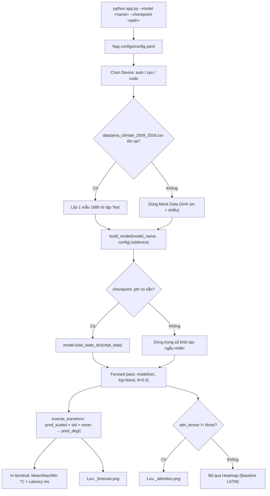

# ĐẶC TẢ THIẾT KẾ GIAO DIỆN DEMO CLI (DEMO SPEC)

---

## 1. Purpose (Mục đích)
- **Mục tiêu:** Xây dựng công cụ demo dòng lệnh (CLI Demo) thông qua `app.py`, phục vụ buổi bảo vệ đồ án và kiểm tra nhanh hệ thống dự báo thời tiết mà không cần trình duyệt hay giao diện web.
- **Tính năng trọng tâm:**
  1. *Nạp mô hình & Checkpoint linh hoạt:* Người dùng chỉ định 1 trong 3 kiến trúc mô hình (`seq2seq_lstm`, `seq2seq_attention`, `transformer`) và đường dẫn file `.pth` bằng tham số dòng lệnh. Nếu không truyền, hệ thống **tự động tìm** checkpoint `_best.pth` tốt nhất trong `checkpoints/`.
  2. *Dự báo tức thì (Inference):* Nếu có file CSV gốc Jena Climate, lấy ngẫu nhiên 1 mẫu 168h từ tập Test để dự báo. Nếu không, dùng Mock Data hình sin mô phỏng.
  3. *Xuất biểu đồ PNG tự động:* Lưu biểu đồ đường nhiệt độ 72h (kèm dải dung sai $\pm 1.5^\circ\text{C}$) và Attention Heatmap ($72 \times 168$) vào thư mục `evalution_results/`.
  4. *Giám sát hiệu năng:* In ra terminal độ trễ suy luận (ms), nhiệt độ trung bình / cao nhất / thấp nhất của 72 giờ dự báo.

---

## 2. Input / Output Contract (Hợp đồng Đầu vào & Đầu ra)

### 2.1 Đầu vào của ứng dụng Demo CLI
- **Tham số dòng lệnh:**

| Tham số | Giá trị mặc định | Mô tả |
|---|---|---|
| `--model` | `seq2seq_attention` | Kiến trúc: `seq2seq_lstm` / `seq2seq_attention` / `transformer` |
| `--checkpoint` | `None` (tự tìm) | Đường dẫn file `.pth` (ví dụ: `checkpoints/seq2seq_attention_20261116-204500_best.pth`) |
| `--device` | `auto` | `auto` / `cpu` / `cuda` |
| `--config` | `configs/config.yaml` | Đường dẫn file cấu hình YAML |
| `--output_dir` | `evalution_results` | Thư mục lưu biểu đồ PNG đầu ra |

- **Dữ liệu thời tiết đầu vào:**
  - *Chế độ 1 (ưu tiên):* Lấy 1 mẫu ngẫu nhiên từ tập Test của Jena Climate (nếu `data/jena_climate_2009_2016.csv` tồn tại).
  - *Chế độ 2 (dự phòng):* Tensor nhiễu ngẫu nhiên `(1, 168, 14)` với giá trị nhiệt độ thực mô phỏng hình sin.

### 2.2 Đầu ra của ứng dụng Demo CLI
- **Thông tin in ra terminal:**
  - Thiết bị đang dùng, tên mô hình, nguồn dữ liệu.
  - Nhiệt độ trung bình / cao nhất / thấp nhất (°C) và độ trễ suy luận (ms).
- **File PNG lưu tại `evalution_results/`:**
  - `<model_name>_forecast.png`: Biểu đồ đường 72h với dải dung sai $\pm 1.5^\circ\text{C}$.
  - `<model_name>_attention.png`: Attention Heatmap $72 \times 168$ (chỉ cho Model 2 & 3).

> [!NOTE]
> `app.py` không phụ thuộc vào bất kỳ thư viện giao diện web nào. Toàn bộ trực quan hóa sử dụng **Matplotlib** với backend `Agg` (non-interactive), đảm bảo chạy được trên máy chủ không có màn hình (headless server).

---

## 3. Success Criteria (Tiêu chí Nghiệm thu Ứng dụng Demo)

1. **Khởi động thành công không lỗi:**
   - Lệnh `python app.py --model seq2seq_attention` chạy hoàn chỉnh và in log tóm tắt ra terminal mà không ném ngoại lệ.
2. **Xuất file biểu đồ đúng:**
   - File `evalution_results/seq2seq_attention_forecast.png` phải tồn tại và kích thước > 0 bytes sau khi chạy.
   - File `evalution_results/seq2seq_attention_attention.png` phải tồn tại khi dùng Model 2 hoặc Model 3.
3. **Tốc độ suy luận:**
   - Độ trễ suy luận 1 mẫu trên CPU phải dưới **500 ms**.
4. **Xử lý lỗi nhẹ nhàng (Graceful Degradation):**
   - Nếu không có checkpoint, dùng trọng số khởi tạo ngẫu nhiên và in cảnh báo thay vì crash.
   - Nếu không có dữ liệu gốc, dùng Mock Data và in cảnh báo thay vì crash.

---

## 4. How to do (Quy trình Thực thi Demo CLI)



### 4.1 Câu lệnh chạy Demo

```bash
# Chạy demo với mô hình Seq2Seq Attention (tự động tìm checkpoint tốt nhất)
python app.py --model seq2seq_attention

# Chỉ định rõ checkpoint và thiết bị
python app.py --model transformer --checkpoint checkpoints/transformer_20261116-204500_best.pth --device cpu

# Chỉ định thư mục đầu ra tùy chỉnh
python app.py --model seq2seq_lstm --output_dir my_results
```

### 4.2 Ví dụ log terminal khi chạy thành công

```text
[DEMO] Thiết bị sử dụng: cpu
[DEMO] Mô hình: seq2seq_attention
[DEMO] Đã nạp 1 mẫu 168h thực tế từ tập Test (Jena Climate).
[DEMO] Đã nạp trọng số từ: checkpoints/seq2seq_attention_20261116-204500_best.pth

[DEMO] ===== KẾT QUẢ DỰ BÁO 72 GIỜ =====
  Nhiệt độ trung bình: 14.73 °C
  Nhiệt độ cao nhất  : 19.21 °C
  Nhiệt độ thấp nhất :  8.05 °C
  Độ trễ suy luận    : 42.57 ms
  [PLOT] Biểu đồ dự báo đã lưu tại: evalution_results/seq2seq_attention_forecast.png
  [PLOT] Attention Heatmap đã lưu tại: evalution_results/seq2seq_attention_attention.png

[DEMO] Hoàn tất. Biểu đồ được lưu tại: evalution_results/
```
