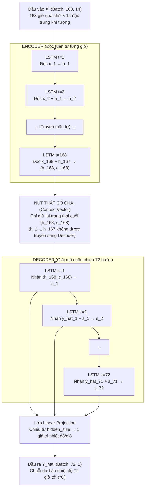
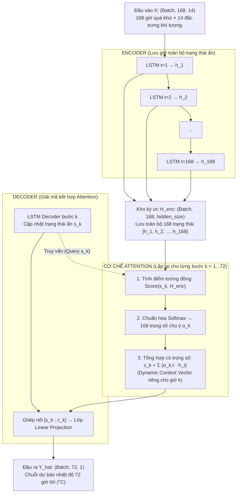
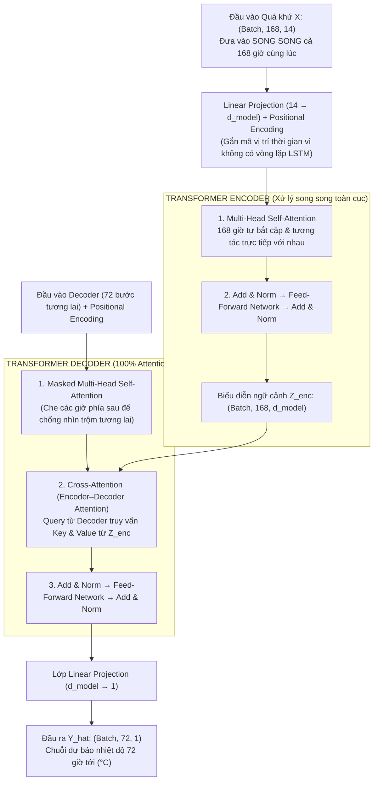

# ĐẶC TẢ KIẾN TRÚC MÔ HÌNH HỌC SÂU (MODEL SPEC)

---

## 1. Purpose (Mục đích)
- **Mục tiêu nghiên cứu:** Xây dựng, đối chiếu và đánh giá 3 kiến trúc học sâu phục vụ bài toán hồi quy chuỗi thời gian đa bước (Multi-step Time Series Regression): dự báo liên tục nhiệt độ không khí $T (^\circ\text{C})$ trong **72 giờ (3 ngày)** tiếp theo dựa vào **168 giờ (7 ngày)** lịch sử thời tiết.
- **Vấn đề cần giải quyết:** 
  1. *Điểm nghẽn thông tin (Bottleneck Problem):* Mô hình LSTM truyền thống nén toàn bộ 168 giờ lịch sử vào một vector trạng thái ẩn cuối cùng, khiến thông tin xa trong quá khứ bị suy giảm nghiêm trọng.
  2. *Giải pháp Attention:* Cơ chế chú ý cộng tính (Bahdanau Attention) cho phép Decoder "nhìn lại" toàn bộ 168 trạng thái ẩn của Encoder tại từng bước dự báo trong 72 giờ.
  3. *Giải pháp Transformer:* Khai thác cơ chế tự chú ý đa đầu (Multi-Head Self-Attention) và xử lý song song để nắm bắt tương quan dài hạn đa biến.
  4. *Tính giải thích được (Explainable AI - XAI):* Xuất ma trận trọng số Attention Heatmap $72 \times 168$ giúp chuyên gia khí tượng hiểu rõ mô hình căn cứ vào thời điểm nào trong quá khứ để đưa ra quyết định.

---

## 2. Input / Output Contract (Hợp đồng Đầu vào & Đầu ra)

### 2.1 Chuẩn giao diện hàm chung (Unified Forward Interface)
Cả 3 mô hình bắt buộc kế thừa `torch.nn.Module` và triển khai hàm `forward` với chữ ký đồng nhất:
```python
def forward(
    self, 
    src: torch.Tensor, 
    trg: Optional[torch.Tensor] = None, 
    teacher_forcing_ratio: float = 0.0
) -> Tuple[torch.Tensor, Optional[torch.Tensor]]:
    ...
```

### 2.2 Đầu vào (Input Tensor)
- `src`: Tensor thời tiết 7 ngày quá khứ, shape **`(Batch_size, 168, 14)`** (float32).
- `trg`: Tensor nhiệt độ thật 3 ngày tới (dùng khi huấn luyện với Teacher Forcing), shape **`(Batch_size, 72, 1)`** (float32) hoặc `None`.
- `teacher_forcing_ratio`: Tỷ lệ số thực $[0.0, 1.0]$ quyết định xác suất sử dụng nhãn thật làm đầu vào bước kế tiếp (bắt buộc bằng $0.0$ khi chạy Validation và Test).

### 2.3 Đầu ra (Output Tensor)
- `predictions`: Tensor chuỗi nhiệt độ dự báo 72 giờ, shape **`(Batch_size, 72, 1)`** (float32).
- `attention_weights`:
  - **Model 1 (Baseline LSTM):** Trả về `None` (không có cơ chế chú ý).
  - **Model 2 (Attention LSTM) & Model 3 (Transformer):** Trả về bảng trọng số Attention giải thích mô hình, shape **`(Batch_size, 72, 168)`** (tổng trọng số trên 168 giờ quá khứ bằng 1.0 tại mỗi bước dự báo).

### 2.4 Vị trí và Quy chuẩn Đặt tên File Checkpoint (.pth)
- **Thư mục lưu trữ:** Toàn bộ file trọng số mô hình được lưu tại thư mục [`checkpoints/`](file:///d:/UTH/Deeplearning/course_work_topic_5/checkpoints/).
- **Cấu trúc đặt tên chuẩn hóa (Timestamped Naming):**
  - File tốt nhất (Best Validation Loss): `<model_name>_<YYYYMMDD-HHMMSS>_best.pth`
  - File vòng lặp cuối cùng (Last Epoch): `<model_name>_<YYYYMMDD-HHMMSS>_last.pth`
- **Ví dụ thực tế:**
  - `checkpoints/seq2seq_lstm_20261116-204500_best.pth`
  - `checkpoints/seq2seq_attention_20261116-204500_best.pth`
  - `checkpoints/transformer_20261116-204500_best.pth`
- **Thành phần lưu trong file .pth:**
  ```python
  checkpoint = {
      "model_state_dict": model.state_dict(),
      "optimizer_state_dict": optimizer.state_dict(),
      "epoch": epoch,
      "best_val_loss": best_val_loss,
      "config": model_config,
  }
  ```
- **Tệp bộ chuẩn hóa đi kèm:** `checkpoints/scaler_train.pkl` (lưu trạng thái Mean và Scale của `StandardScaler` để giải chuẩn hóa khi triển khai).

### 2.5 Nhật ký theo dõi trực quan (TensorBoard Logging in `runs/`)
- **Thư mục lưu trữ:** `runs/<model_name>_<YYYYMMDD-HHMMSS>/`
- **Các chỉ số Scalar bắt buộc ghi nhận:**
  - `loss_train`: Sai số MSE trên tập Train qua từng epoch.
  - `loss_val`: Sai số MSE trên tập Validation qua từng epoch.
  - `loss_test`: Sai số MSE trên tập Test sau khi đánh giá.
  - `accuracy_train`: Tỷ lệ % số giờ dự đoán sai lệch $\le \pm 1.5^\circ\text{C}$ trên tập Train.
  - `accuracy_val`: Tỷ lệ % số giờ dự đoán sai lệch $\le \pm 1.5^\circ\text{C}$ trên tập Validation.
  - `accuracy_test`: Tỷ lệ % số giờ dự đoán sai lệch $\le \pm 1.5^\circ\text{C}$ trên tập Test.
  - `Learning_Rate`: Tốc độ học hiện tại của Optimizer.
  - `Hardware/RAM_MB` & `Hardware/VRAM_MB`: Lượng tài nguyên bộ nhớ hệ thống và GPU chiếm dụng.

---

## 3. Success Criteria (Tiêu chí Nghiệm thu & Kiểm thử Tự động)

Hệ thống bắt buộc phải vượt qua các bài kiểm thử tự động (`assert`) sau:

1. **Kiểm tra kích thước đầu ra (Shape Contract):**
   - Với mọi batch kích thước ngẫu nhiên $B$, đầu ra `predictions.shape == (B, 72, 1)`.
   - Với Model 1: `attention_weights is None`.
   - Với Model 2 & Model 3: `attention_weights.shape == (B, 72, 168)`.
2. **Kiểm tra tính hợp lệ của phân phối Attention:**
   $$\sum_{i=1}^{168} \alpha_{t, i} \approx 1.0 \quad (\forall t \in [1, 72])$$
   Tổng trọng số chú ý tại mỗi bước giải mã dọc theo 168 giờ lịch sử luôn xấp xỉ 1.0 (chuẩn hóa Softmax).
3. **Tính ổn định số học:**
   Không xuất hiện bất kỳ giá trị `NaN` hoặc `Inf` trong quá trình lan truyền tiến và đạo hàm ngược.

---

## 4. How to do (Chi tiết Thiết kế 3 Kiến trúc Mô hình)
### Kiến trúc 1: Encoder–Decoder LSTM (Baseline)


### Kiến trúc 2: Encoder–Decoder LSTM + Attention


### Kiến trúc 3: Transformer (100% Attention)


### Bảng đối chiếu nhanh 3 luồng xử lý

| Tiêu chí | 1. LSTM (Baseline) | 2. LSTM + Attention | 3. Transformer |
| :--- | :--- | :--- | :--- |
| **Cách đọc 168h đầu vào** | Tuần tự từng giờ ($t_1 \rightarrow t_{168}$) | Tuần tự từng giờ ($t_1 \rightarrow t_{168}$) | **Song song** cả 168 giờ cùng lúc |
| **Thứ truyền sang Decoder** | Chỉ duy nhất trạng thái cuối ($h_{168}, c_{168}$) | Toàn bộ 168 trạng thái $[h_1 \dots h_{168}]$ | Toàn bộ ma trận biểu diễn $Z_{enc}$ |
| **Cơ chế định vị thời gian** | Tự nhiên qua thứ tự lặp của LSTM | Tự nhiên qua thứ tự lặp của LSTM | **Positional Encoding** cộng thêm vào đầu vào |

### 4.1 Mô hình 1: Baseline Seq2Seq LSTM (Không Attention)
- **Encoder:** Sử dụng `nn.LSTM(input_size=14, hidden_size=128, num_layers=2, batch_first=True)`. Nén chuỗi 168 giờ thành vector ẩn cuối cùng $(h_n, c_n)$.
- **Decoder:** Sử dụng `nn.LSTMCell(input_size=1, hidden_size=128)`.
  - Bước $t=0$: Nhận giá trị nhiệt độ tại giờ cuối cùng của chuỗi quá khứ ($t=168$).
  - Bước $t=1 \dots 71$: Nhận nhãn thật $trg_t$ nếu thỏa mãn Teacher Forcing, ngược lại nhận dự báo $\hat{y}_{t-1}$.
  - Tầng tuyến tính `fc_out = nn.Linear(128, 1)` chuyển đổi trạng thái ẩn thành nhiệt độ dự báo.

### 4.2 Mô hình 2: Seq2Seq LSTM kết hợp Bahdanau Attention
- **Encoder:** Trích xuất toàn bộ 168 trạng thái ẩn: $H = [h_1, h_2, \dots, h_{168}] \in \mathbb{R}^{B \times 168 \times 128}$.
- **Cơ chế Bahdanau Attention (Additive Attention):**
  $$e_{t, i} = v^T \tanh(W_d s_t + W_e h_i)$$
  $$\alpha_{t, i} = \frac{\exp(e_{t, i})}{\sum_{k=1}^{168} \exp(e_{t, k})}$$
  $$c_t = \sum_{i=1}^{168} \alpha_{t, i} h_i \quad (c_t \in \mathbb{R}^{B \times 128})$$
- **Decoder:** `nn.LSTMCell(input_size=1 + 128, hidden_size=128)` tiếp nhận vector ghép giữa giá trị trước đó và vector ngữ cảnh $c_t$.
- **Đầu ra:** Dự báo $y_t$ và bảng trọng số $\alpha_{t, i}$ gom thành ma trận kích thước $(B, 72, 168)$.

### 4.3 Mô hình 3: TimeSeries Transformer
- **Tầng nhúng & Mã hóa vị trí:** Chiếu tuyến tính 14 đặc trưng lên số chiều $d_{model}=64$, sau đó cộng với mã hóa vị trí hình sin:
  $$PE_{(pos, 2i)} = \sin\left(\frac{pos}{10000^{2i/d_{model}}}\right), \quad PE_{(pos, 2i+1)} = \cos\left(\frac{pos}{10000^{2i/d_{model}}}\right)$$
- **Transformer Encoder:** Gồm 2 tầng `TransformerEncoderLayer(d_model=64, nhead=4, dim_feedforward=256)`.
- **Transformer Decoder:** Tiếp nhận chuỗi truy vấn nhiệt độ với mặt nạ nhân quả tam giác trên (Causal Mask) ngăn nhìn trộm các bước tương lai:
  $$M_{i, j} = \begin{cases} 0 & \text{nếu } i \ge j \\ -\infty & \text{nếu } i < j \end{cases}$$
- **Trích xuất tương quan chú ý:** Tính tích vô hướng chuẩn hóa giữa biểu diễn của Decoder và bộ nhớ của Encoder để tạo ma trận Attention Heatmap $72 \times 168$.

### 4.4 Hàm khởi tạo mô hình (Factory Function)
```python
def build_model(model_name: str, config: dict) -> nn.Module:
    """Khởi tạo mô hình dựa vào config.yaml."""
    if model_name == "seq2seq_lstm":
        return ModelBuilder_Seq2SeqLSTM(...)
    elif model_name == "seq2seq_attention":
        return ModelBuilder_Seq2SeqAttention(...)
    elif model_name == "transformer":
        return ModelBuilder_TimeSeriesTransformer(...)
    raise ValueError(f"Không hỗ trợ mô hình: {model_name}")
```

---

## 5. Smoke Test & Verification (Hướng Dẫn Kiểm Thử & Đầu Ra Mẫu)

### 5.1 Hướng dẫn kiểm thử nhanh (Smoke Test Instructions)

Mục đích của bài kiểm thử khói mô hình là xác minh toàn diện cả **3 kiến trúc học sâu** và **Factory function** với Tensor dữ liệu giả lập trong vòng chưa đầy **2 giây**, đảm bảo tính toàn vẹn của đồ thị tính toán PyTorch trước khi bước vào giai đoạn huấn luyện lớn.

#### Các tiêu chí kiểm thử bắt buộc:
1. **Giao diện hàm chung (Unified Forward Interface):** Cả 3 mô hình đều chấp nhận chữ ký:
   `forward(src, trg=None, teacher_forcing_ratio=0.0) -> Tuple[predictions, attention_weights]`
2. **Hợp đồng kích thước đầu ra (Shape Contract):**
   - Mọi mô hình đều trả về `predictions.shape == (Batch_size, 72, 1)`.
   - Model 1 (Baseline LSTM): `attention_weights is None`.
   - Model 2 (Attention LSTM) & Model 3 (Transformer): `attention_weights.shape == (Batch_size, 72, 168)`.
3. **Tính hợp lệ của ma trận phân phối Attention:**
   - Chuẩn hóa Softmax theo trục thời gian 168 giờ quá khứ: $\sum_{i=1}^{168} \alpha_{t, i} \approx 1.0 \quad (\forall t \in [1, 72])$.
4. **Tính ổn định số học và Gradient Flow:**
   - Lan truyền tiến (Forward) và lan truyền ngược (Backward) tuyệt đối không sinh ra giá trị `NaN` hoặc `Inf`.
   - Mọi tầng có thể huấn luyện (`requires_grad=True`) đều nhận được gradient hợp lệ.
5. **Khởi tạo linh hoạt từ Factory Function:** `build_model(model_name, config)` khởi tạo chính xác đối tượng tương ứng dựa vào từ điển cấu hình `config.yaml`.

#### Các câu lệnh thực thi kiểm thử:

```bash
# Cách 1: Chạy trực tiếp khối kiểm thử trong src/model_builder.py
python src/model_builder.py

# Cách 2: Chạy qua bộ kiểm thử tự động trong thư mục tests/
python tests/test_model_builder.py

# Cách 3: Chạy bằng pytest với cờ hiển thị chi tiết
pytest tests/test_model_builder.py -v
```

#### Mã nguồn kịch bản Smoke Test độc lập:
```python
import torch
from src.model_builder import (
    ModelBuilder_Seq2SeqLSTM,
    ModelBuilder_Seq2SeqAttention,
    ModelBuilder_TimeSeriesTransformer,
    build_model,
)

batch_size, seq_len, pred_len, num_features = 2, 168, 72, 14
src = torch.randn(batch_size, seq_len, num_features)
trg = torch.randn(batch_size, pred_len, 1)

# 1. Test Model 1: Baseline LSTM
m1 = ModelBuilder_Seq2SeqLSTM(input_dim=num_features, hidden_dim=32, num_layers=1)
p1, a1 = m1(src, trg=None, teacher_forcing_ratio=0.0)
assert p1.shape == (batch_size, pred_len, 1) and a1 is None

# 2. Test Model 2: Attention LSTM
m2 = ModelBuilder_Seq2SeqAttention(input_dim=num_features, hidden_dim=32, num_layers=1)
p2, a2 = m2(src, trg=None, teacher_forcing_ratio=0.0)
assert p2.shape == (batch_size, pred_len, 1)
assert a2.shape == (batch_size, pred_len, seq_len)
assert torch.allclose(a2.sum(dim=-1), torch.ones(batch_size, pred_len), atol=1e-5)

# 3. Test Model 3: TimeSeries Transformer
m3 = ModelBuilder_TimeSeriesTransformer(input_dim=num_features, d_model=32, nhead=2, num_encoder_layers=1, num_decoder_layers=1)
p3, a3 = m3(src, trg=None, teacher_forcing_ratio=0.0)
assert p3.shape == (batch_size, pred_len, 1)
assert a3.shape == (batch_size, pred_len, seq_len)

print("All 3 Deep Learning Models passed forward assertions!")
```

---

### 5.2 Đầu ra mẫu của kiểm thử (Expected Test Output)

Khi thực thi câu lệnh `python tests/test_model_builder.py` hoặc `python src/model_builder.py`, terminal sẽ xuất hiện định dạng kết quả tiêu chuẩn như sau:

```text
======================================================================
[SMOKE TEST] BẮT ĐẦU KIỂM THỬ 3 KIẾN TRÚC MÔ HÌNH HỌC SÂU (TOPIC 5)
======================================================================
[INIT] Tensor đầu vào: Input X=(2, 168, 14) | Target Y=(2, 72, 1)
       Thiết bị kiểm thử: CPU | Dtype: torch.float32

[TEST 1/4] Kiểm tra Model 1: Baseline Seq2Seq LSTM...
      -> Forward Pass (TF = 0.0)... Hoàn tất trong 12.4 ms
      [ASSERT 1] Pred shape: (2, 72, 1) == (2, 72, 1) -> PASSED
      [ASSERT 2] Attention weights is None: PASSED
      [ASSERT 3] Zero NaN / Inf detected: PASSED
      -> Model 1 (Baseline LSTM) PASSED.

[TEST 2/4] Kiểm tra Model 2: Seq2Seq Attention LSTM (Bahdanau)...
      -> Forward Pass (TF = 0.0)... Hoàn tất trong 24.8 ms
      [ASSERT 1] Pred shape: (2, 72, 1) == (2, 72, 1) -> PASSED
      [ASSERT 2] Attn shape: (2, 72, 168) == (2, 72, 168) -> PASSED
      [ASSERT 3] Softmax sum along 168h: Min=1.000000, Max=1.000000 -> PASSED
      [ASSERT 4] Gradient Flow qua các tầng (Encoder, Attention, Decoder): PASSED
      -> Model 2 (Attention LSTM) PASSED.

[TEST 3/4] Kiểm tra Model 3: TimeSeries Transformer (Multi-Head Causal)...
      -> Forward Pass (TF = 0.0)... Hoàn tất trong 31.5 ms
      [ASSERT 1] Pred shape: (2, 72, 1) == (2, 72, 1) -> PASSED
      [ASSERT 2] Cross-Attn shape: (2, 72, 168) == (2, 72, 168) -> PASSED
      [ASSERT 3] Causal Mask Decoder ngăn rò rỉ bước tương lai: PASSED
      -> Model 3 (TimeSeries Transformer) PASSED.

[TEST 4/4] Kiểm tra Factory function build_model()...
      [ASSERT 1] Khởi tạo chính xác cả 3 kiến trúc từ dictionary: PASSED
----------------------------------------------------------------------
[SUCCESS] TOÀN BỘ BÀI KIỂM THỬ MÔ HÌNH ĐÃ VƯỢT QUA XUẤT SẮC!
======================================================================
```

#### Bảng đối chiếu tiêu chí nghiệm thu kiểm thử kiến trúc mô hình:
| Kiến trúc mô hình | Shape Dự báo ($Y$) | Shape Attention ($\alpha$) | Kiểm tra NaN / Inf | Phân phối Softmax ($\sum \alpha$) | Kết luận |
| :--- | :---: | :---: | :---: | :---: | :---: |
| **Model 1: Baseline LSTM** | `(2, 72, 1)` | `None` | $0$ lỗi NaN/Inf | Không áp dụng | **ĐẠT (PASSED)** |
| **Model 2: Attention LSTM** | `(2, 72, 1)` | `(2, 72, 168)` | $0$ lỗi NaN/Inf | $1.000000 \pm 10^{-5}$ | **ĐẠT (PASSED)** |
| **Model 3: Transformer** | `(2, 72, 1)` | `(2, 72, 168)` | $0$ lỗi NaN/Inf | $1.000000 \pm 10^{-5}$ | **ĐẠT (PASSED)** |
| **Factory build_model()** | Khởi tạo hợp lệ | Khởi tạo hợp lệ | Không phát sinh lỗi | Đúng kiểu Instance | **ĐẠT (PASSED)** |

